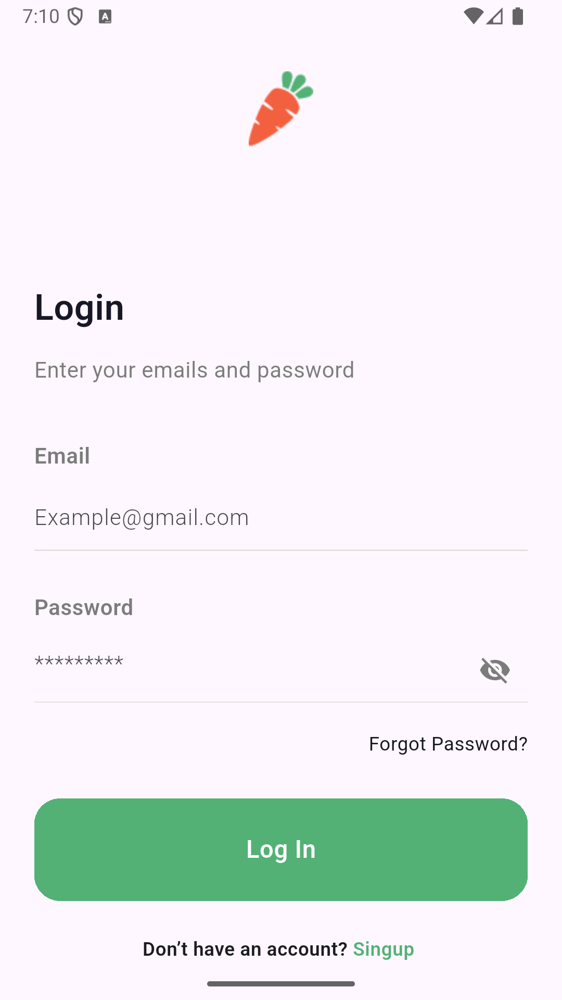
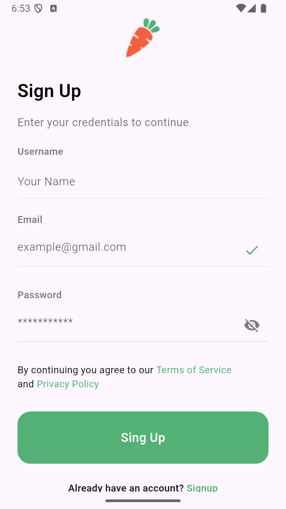
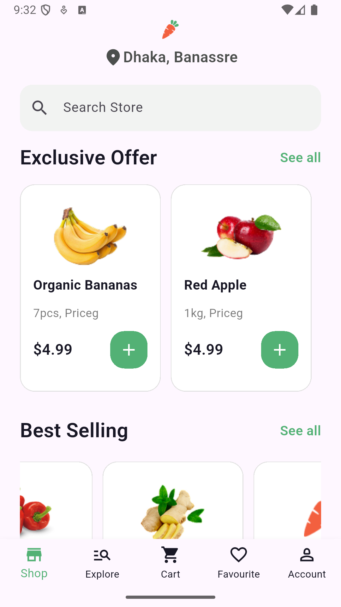
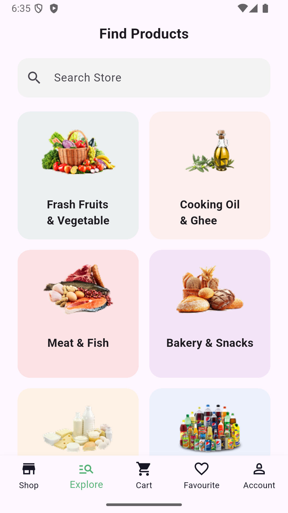
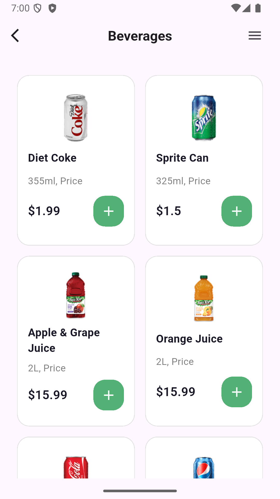
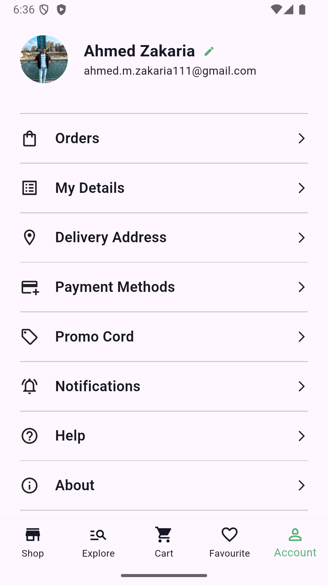

# 🥕 Groceries App

A clean, modern mobile application for online grocery shopping built with **Flutter**. Designed with a focus on simplicity, smooth user onboarding, and an intuitive product discovery experience.


---

## 📱 Screenshots

| Login Screen | Sign Up Screen | Home Screen |
| :---: | :---: | :---: |
|  |  |  |

| Explore Screen | Beverages Screen | Account Screen |
| :---: | :---: | :---: |
|  |  |  |

---

## ✨ Features

- **User Authentication:**
  - **Login:** Email and password authentication with a "Forgot Password?" recovery option and navigation to the main store.
  - **Sign Up:** Account registration with username, email validation indicator, and password visibility toggle.
- **Home & Store Discovery:**
  - **Location & Search:** Current delivery location header and a quick `Search Store` bar.
  - **Product Carousels:** Horizontal scrollable sections for **Exclusive Offer** and **Best Selling** items using custom reusable `ProductCard` widgets.
  - **Grocery Categories:** Highlighted category cards (such as *Pulses* and *Rice*) alongside meat and poultry listings.
- **Explore (`Find Products`):**
  - Product search bar and a 2-column category grid (*Fresh Fruits & Vegetable*, *Cooking Oil & Ghee*, *Meat & Fish*, *Bakery & Snacks*, *Dairy & Eggs*, and *Beverages*) with color-tinted cards and category navigation.
- **Beverages Screen:**
  - Dedicated 2-column product grid accessible from **Explore → Beverages**, showcasing drinks (*Diet Coke*, *Sprite Can*, *Apple & Grape Juice*, *Orange Juice*, *Coca Cola Can*, *Pepsi Can*) with prices and add-to-cart buttons.
- **Account & Profile:**
  - Profile header with avatar, user name, email, and edit icon.
  - Account menu options (*Orders*, *My Details*, *Delivery Address*, *Payment Methods*, *Promo Code*, *Notifications*, *Help*, *About*) and a **Logout** button.
- **Bottom Navigation Bar:** Clean 5-tab navigation (`BottomNavBarScreen`) across **Shop**, **Explore**, **Cart**, **Favourite**, and **Account**.

---

## 🛠️ Tech Stack

- **Framework:** [Flutter](https://flutter.dev/)
- **Language:** [Dart](https://dart.dev/)
- **UI & Design:** Material Design, Custom Reusable Widgets

---

## 📂 Project Structure

```text
groceries_app/
├── assets/                       # Categorized product, category, & icon images
│   ├── account/
│   ├── beverages/
│   ├── common/
│   ├── explore/
│   ├── home/
│   └── icons/
├── lib/
│   ├── widgets/                  # Reusable custom UI components
│   │   ├── app_button.dart
│   │   ├── app_form_field.dart
│   │   ├── app_home_row.dart
│   │   ├── app_product_card.dart
│   │   ├── app_product_horizontal_list.dart
│   │   └── app_search_field.dart
│   ├── account_screen.dart       # User profile & account settings screen
│   ├── beverages_screen.dart     # Beverages category product grid screen
│   ├── bottom_nav_bar_screen.dart # 5-tab bottom navigation wrapper
│   ├── explore_screen.dart       # Product categories & search screen
│   ├── groceries_app.dart        # Root MaterialApp widget
│   ├── home_screen.dart          # Main shop & product discovery screen
│   ├── login_screen.dart         # User login screen
│   ├── main.dart                 # Application entry point
│   └── signup_screen.dart        # User registration screen
└── screenshots/                  # App UI screenshots
```
